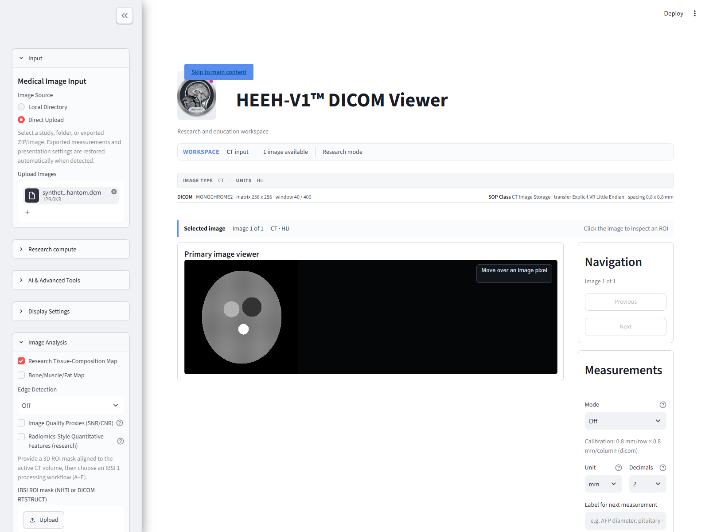
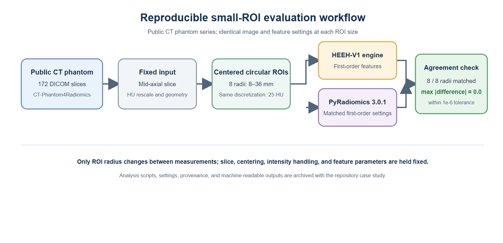

# Summary

HEEH-V1 is an open-source Python/Streamlit application for reproducible medical-image research and education. It provides an integrated environment for DICOM and selected volumetric-image viewing, calibrated measurements, CT intensity analysis, multiplanar and three-dimensional research visualization, radiomics-style feature calculation, provenance-aware export, and export validation.

The software is designed for researchers, educators, and biomedical engineers who need a transparent, extensible environment in which imaging workflows can be inspected, documented, and reproduced. HEEH-V1 is released under the MIT License and is explicitly intended for research and education rather than clinical care.

# Statement of Need

Medical imaging research depends on reliable image import, consistent intensity handling, transparent quantitative processing, and clear records of how images and derived outputs are generated. In many research settings, analysis values must be separated from display-only transformations, while export processes should preserve sufficient provenance to allow later review or reproduction.

Existing tools provide strong capabilities in individual areas, but researchers and educators may still need a lightweight, integrated environment in which image inspection, measurement, quantitative analysis, and export validation can be performed together. HEEH-V1 addresses this need by combining these functions in a single Streamlit application with explicit documentation of its scientific and clinical boundaries.

HEEH-V1 is not a certified medical device. It is not intended for diagnosis, prognosis, treatment planning, triage, or any patient-care decision. A feature being implemented in the software does not imply that every imaging modality, scanner, encoding, or clinical workflow has been validated.

# State of the Field

Established platforms such as 3D Slicer, OHIF, and PyRadiomics provide mature capabilities for image computing, visualization, and radiomics [@fedorov2012; @pereira2025; @vanGriethuysen2017]. 3D Slicer is a widely used open-source platform for medical-image computing and visualization, while OHIF provides web-based viewing workflows for medical imaging. PyRadiomics is a widely used open-source radiomics feature-extraction library.

HEEH-V1 is not intended to replace these platforms. Instead, it provides a complementary, education-friendly Streamlit environment that integrates selected viewing, measurement, quantitative imaging, and export-validation workflows. Its contribution is not a new diagnostic algorithm or a claim of superiority over established systems; rather, it is an integrated, transparent research environment with documented evidence boundaries.

Radiomics research also requires careful attention to feature definitions, preprocessing, region-of-interest structure, and reproducibility [@zwanenburg2020; @lei2021; @bettinelli2022]. Variation in these factors can affect quantitative outputs and complicate comparison across tools. HEEH-V1 therefore documents its tested workflows and distinguishes implemented functionality from independently validated capability.

# Research Impact Statement

A reproducible research use case included in the repository investigates the effect of region-of-interest (ROI) size on HEEH-V1 first-order CT metrics. The workflow analyses a public CT phantom series from the CT-Phantom4Radiomics collection [@clark2013; @tciaPhantom] across eight ROI radii, from 8 mm to 36 mm, using identical slice selection, ROI centring, intensity discretisation, and feature definitions.

For every tested ROI size, HEEH-V1’s matched first-order outputs agreed exactly with PyRadiomics 3.0.1 [@vanGriethuysen2017] at the specified absolute-difference tolerance. The use case also shows that central-tendency metrics were relatively more stable across ROI sizes, whereas dispersion and distribution-shape metrics changed substantially. These findings demonstrate a concrete quantitative-imaging workflow enabled by the software and provide reusable analysis materials for independent reproduction.

The complete use case, including dataset provenance, analysis configuration, executable script, machine-readable results, and figures, is available in the [repository case study](https://github.com/m39heeh-art/HEEH-V1-DICOM-Viewer/tree/main/verification/research_case).

*Figure 1: HEEH-V1 viewer with a synthetic CT phantom DICOM fixture.*

*Figure 2: The fixed-slice, eight-ROI workflow compares HEEH-V1 and PyRadiomics at each radius.*

# Software Design
The implementation separates image values used for analysis from display transformations. Where appropriate, DICOM rescale metadata are applied to analysis values, while display windowing and other visual transformations remain separate [@dicom]. This design is intended to reduce ambiguity between what a user sees on screen and the numerical values used in quantitative workflows.

The application includes provenance-aware export functionality and guarded export validation. Export products can be packaged with metadata describing their origin and processing context, while validation workflows are designed to detect selected forms of archive or manifest inconsistency. These features are intended to support reproducible research workflows rather than to provide a guarantee of anonymity, legal compliance, or protection against all security threats.

The repository includes automated tests, documentation, a pinned dependency lock file, Docker support, continuous-integration configuration, and a Zenodo archival record [@heeh2026]. The source code is released under the MIT License, and the project provides a citation file to support reproducible referencing.

# Availability and Requirements

Project name: HEEH-V1™ DICOM Viewer

Project home page: https://github.com/m39heeh-art/HEEH-V1-DICOM-Viewer

Version-specific archive: https://doi.org/10.5281/zenodo.23835896.

Version-family DOI: https://doi.org/10.5281/zenodo.22768910.

Operating system: Windows, macOS, and Linux installation paths are documented; platform-specific behavior may vary.

Programming language: Python 3.11 or later.

Other requirements: Streamlit and the dependencies listed in the repository’s pinned requirements file. PyRadiomics and Z-Rad are optional dependencies for selected validation workflows.

License: MIT.

Restrictions: The software is intended for research and education only. It is not for clinical or patient-care use.

# AI Usage Disclosure

GitHub Copilot assisted with manuscript drafting and selected code edits during preparation of this package. The final analysis results were generated by executing computational scripts rather than by AI-generated calculations. The author is responsible for reviewing and approving the final text and code and for their accuracy and integrity; this assistance is disclosed in accordance with JOSS policy.

# References
