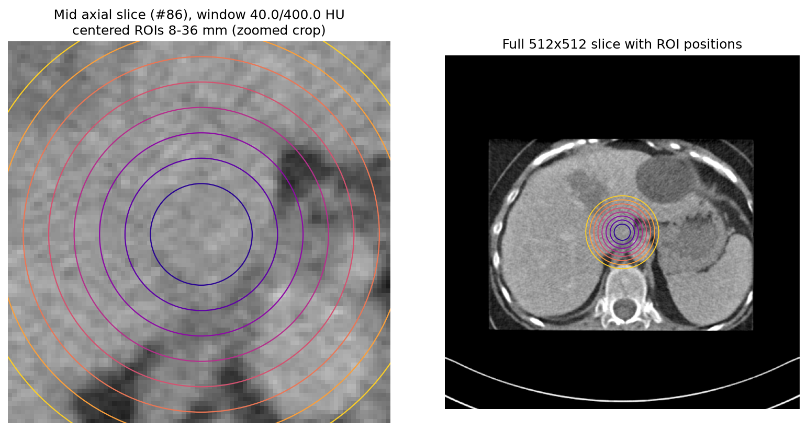
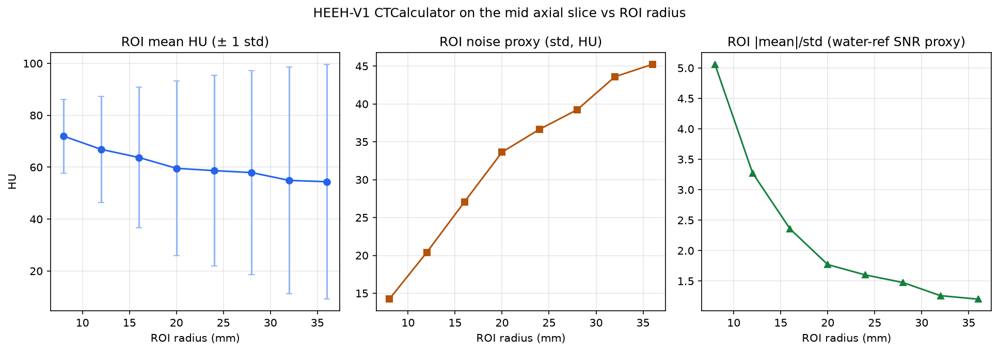
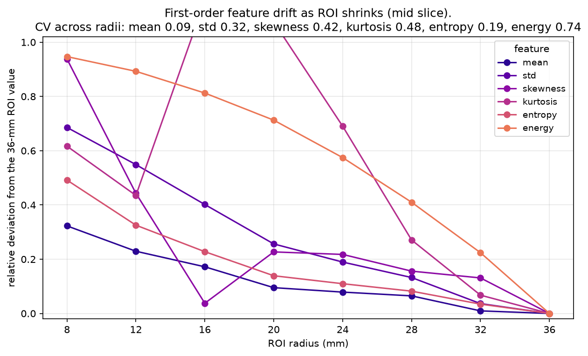
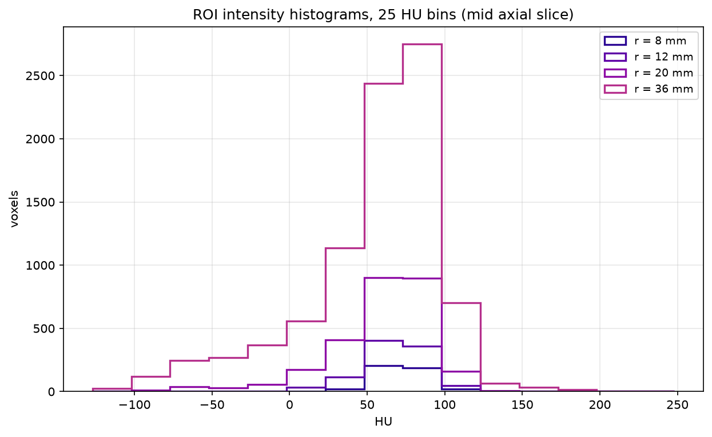

# Research use case — Small-ROI robustness of HEEH-V1 on-board first-order CT metrics

HEEH-V1(TM) DICOM Viewer is requested, in practice, for projects that need
**documented, reproducible, small quantitative analyses** on public medical
imaging data — not just viewing. This directory contains one such realistic
use case, executed end-to-end with the application's own engine code paths and
archived so it can be repeated or audited: the public dataset, exact settings,
the analysis script, machine-readable results, and figures.

> Scope statement (same boundary as the application): this is research and
> education tooling, not a certified medical device. Every number below is a
> measurement on a defined geometric region of a **public CT phantom series**;
> no clinical or diagnostic meaning is attached to any value.

## 1. Dataset

Public TCIA collection `CT-Phantom4Radiomics` (CC BY 4.0,
<https://doi.org/10.7937/a1v1-rc66>), 172 DICOM CT slices, 512×512,
in-plane spacing 0.68359375 mm, slice spacing 2.0 mm. The cached archive was
fingerprint-verified against the recorded download SHA-256
(`579233eb…590f17`) before analysis — details in
[inputs/data_provenance.md](inputs/data_provenance.md) and the refreshed
machine record in [inputs/data_provenance.json](inputs/data_provenance.json).

## 2. Research question

A single, specific, answerable question was fixed before running anything:

> **On the mid axial slice of this series, how do HEEH-V1's on-board
> first-order CT statistics and radiomics features inside a centered circular
> ROI change as the ROI radius shrinks from 36 mm to 8 mm — and does the
> application's exact first-order agreement with PyRadiomics v3.0.1
> (tolerance 1e-6) hold at every tested ROI size?**

This is a real, standard question in quantitative-imaging work: **small-ROI
robustness**. If a feature's value depends strongly on ROI size, two analysts
placing 20 mm vs 12 mm ROIs on the same tissue will get different numbers, so
radiomics pipelines must know which of the viewer's features are safe to
report from even a small clinical ROI and which are not.

## 3. Method and settings (all through HEEH-V1's own code paths)

| Step | HEEH-V1 engine used |
| --- | --- |
| Series loading (GDCM reader by SeriesInstanceUID, HU rescale) | SimpleITK series-reader path identical to the app's IBSI Configuration D loader (reused from `scripts/tcia_real_evaluation.py`) |
| CT ROI statistics (HU mean/std/median, water-reference SNR proxy) | `engines.modality_calculators.ct_calculator.CTCalculator.calculate(slice, roi=mask)` |
| First-order radiomics features | `core.tissue_classifier.RadiomicsExtractor.full_report(ROI_voxels, levels=256, discretization="fixed_bin_width", bin_width=25.0)` |
| ROI shape features | `RadiomicsExtractor.shape_features(mask, spacing)` |
| External comparator | PyRadiomics v3.0.1, matched first-order (binWidth 25.0, voxelArrayShift 0.0, tolerance 1e-6) — the same comparator recorded in `docs/tcia_real_evaluation_report.md` |

Factor under study: **different ROI sizes (radii 8, 12, 16, 20, 24, 28, 32,
36 mm), same slice, same centered ROI placement, identical discretization.**
The design deliberately holds acquisition, slice, and preprocessing fixed so
only ROI size varies. The full canonical settings record (including engine
API strings, stability criterion definition, package versions, and boundary
notes) is in [settings/extraction_settings.json](settings/extraction_settings.json).

Stability criterion (defined in-settings, then applied): a feature is
recorded as *radius-stable* when its coefficient of variation across the
eight tested radii is ≤ 0.10.

## 4. Results

### 4.1 Per-ROI measurements (mid axial slice #86)

| Radius (mm) | ROI voxels | Mean HU | Std (HU) | Entropy (bits) | Skewness | PyRadiomics max abs error |
| ---: | ---: | ---: | ---: | ---: | ---: | ---: |
| 8 | 432 | 71.9491 | 14.2183 | 1.3566 | −0.0766 | 0.0 |
| 12 | 960 | 66.8656 | 20.4095 | 1.8001 | −0.6891 | 0.0 |
| 16 | 1708 | 63.7471 | 27.0701 | 2.0609 | −1.1902 | 0.0 |
| 20 | 2684 | 59.5633 | 33.6422 | 2.2975 | −1.5174 | 0.0 |
| 24 | 3884 | 58.6740 | 36.6663 | 2.3759 | −1.5060 | 0.0 |
| 28 | 5268 | 57.9172 | 39.2446 | 2.4491 | −1.4298 | 0.0 |
| 32 | 6900 | 54.9090 | 43.5946 | 2.5769 | −1.3988 | 0.0 |
| 36 | 8732 | 54.3906 | 45.2380 | 2.6686 | −1.2368 | 0.0 |

Full machine-readable results: [results/small_roi_robustness.json](results/small_roi_robustness.json);
flat table: [results/small_roi_robustness_table.csv](results/small_roi_robustness_table.csv).

### 4.2 Answers to the research question

1. **Engine agreement does not degrade with ROI size.** HEEH-V1's on-board
   first-order engine matched PyRadiomics v3.0.1 with **0.0 absolute error at
   every one of the 8 tested ROI sizes** (432–8732 voxels), well within the
   1e-6 tolerance. `finding_summary.all_radii_within_1e6 = true`,
   `max_abs_error_over_all_radii = 0.0`.
2. **Central-tendency features are radius-stable on this series.** With the
   CV ≤ 0.10 criterion: `mean` (CV 0.093), `median`/`p50`, `p75`, and `p90`
   qualify. Mean HU still drifts +32.3 % from the 36 mm ROI (54.39 HU) to the
   8 mm ROI (71.95 HU) because the ROI samples a spatially structured
   intensity field — stable is relative, and the drift magnitude itself is
   reported rather than hidden.
3. **Every dispersion/shape-of-distribution feature is radius-sensitive.**
   ROI std/noise (CV 0.319: 45.24 → 14.22 HU), skewness (CV 0.416,
   −1.24 → −0.08), kurtosis (CV 0.480, 1.63 → 0.62), entropy (CV 0.187,
   2.67 → 1.36 bits) and energy (CV 0.74) all change strongly with ROI size.
   The large phantom-insert structure entering the ROI with each radius
   increase dominates dispersion features — visible directly in the
   histograms of Fig. 4.
4. **Noise-proxy SNR collapses for small ROIs.** The water-reference SNR
   proxy (|mean|/std) rises from ~1.20 at 36 mm to ~5.06 at 8 mm — a warning
   that small-ROI noise estimates are content-dominated, not pure scanner
   noise, on this structured region.

The practical takeaway for an analyst using this viewer: **report mean/median
and higher percentiles from even a small ROI, but treat std, skewness,
kurtosis, entropy, and energy as ROI-size-dependent and record the ROI size
alongside them.**

### 4.3 Visualizations

| Figure | What it shows |
| --- | --- |
|  [fig1\_roi\_overlay.png](figures/fig1_roi_overlay.png) | Mid slice with all eight centered ROI circles (zoomed crop + full slice) |
|  [fig2\_hu\_stats\_vs\_radius.png](figures/fig2_hu_stats_vs_radius.png) | Mean HU ± std, ROI noise, and SNR proxy vs radius (`CTCalculator`) |
|  [fig3\_firstorder\_stability.png](figures/fig3_firstorder_stability.png) | Relative deviation of each first-order feature from its 36 mm-ROI value, with CVs in the title |
|  [fig4\_roi\_histograms.png](figures/fig4_roi_histograms.png) | ROI intensity histograms at 8/12/20/36 mm, 25 HU bins — the mechanism behind the feature drift |

## 4.4 Cross-checks against the recorded v1.0.2 evaluation

- The 24 mm ROI (3884 voxels) reproduces the values recorded in
  `docs/tcia_real_evaluation_report.md` exactly: mean 58.674047 HU, std
  36.666334 HU, PyRadiomics absolute errors 0.0 — confirming this case
  measures on the same verified engine path and input bytes.
- Input fingerprint match confirmed before analysis (see §1).

## 5. Limitations and scope

- One real public phantom series, one slice, one ROI placement, one
  discretization (25 HU bins, 256 levels); the results describe this series
  and configuration only.
- The stability criterion (CV ≤ 0.10 across radii) is a **study-defined
  descriptive rule**, not an externally validated robustness requirement.
- The in-app ROI radiomics call analyzes ROI voxel values; texture families
  (GLCM/GLRLM/GLSZM/GLDM/NGTDM) require a full finite 2D image and were
  deliberately excluded from the sweep (documented engine boundary in
  `core.tissue_classifier.RadiomicsExtractor.feature_coverage`).
- PyRadiomics agreement is matched first-order only, at one preprocessing
  setting, same as the recorded project evaluations.
- The ROI is a defined geometric region, not a lesion; no diagnostic meaning
  is attached to any measurement, and no clinical accuracy claim is made.

## 6. Reproducing

```bash
python research_case/scripts/run_small_roi_robustness.py
```

The script verifies the cached archive fingerprint, loads the series through
the app's GDCM path, runs the full radius sweep, rewrites
`inputs/data_provenance.json`, `settings/extraction_settings.json`,
`results/small_roi_robustness.json`, `results/small_roi_robustness_table.csv`,
and all four figures, and prints a console summary. Runtime is under a
minute on a desktop CPU.

## 7. File inventory

```
research_case/
|-- README.md                                   # this document
|-- inputs/
|   |-- data_provenance.md                     # dataset identity, license, fingerprints
|   `-- data_provenance.json                   # refreshed fingerprint/geometry record
|-- settings/
|   `-- extraction_settings.json               # canonical engine + study settings
|-- scripts/
|   `-- run_small_roi_robustness.py            # full analysis (HEEH-V1 engine paths)
|-- results/
|   |-- small_roi_robustness.json              # all measurements + stability analysis
|   `-- small_roi_robustness_table.csv         # one row per ROI radius
`-- figures/
    |-- fig1_roi_overlay.png
    |-- fig2_hu_stats_vs_radius.png
    |-- fig3_firstorder_stability.png
    `-- fig4_roi_histograms.png
```
